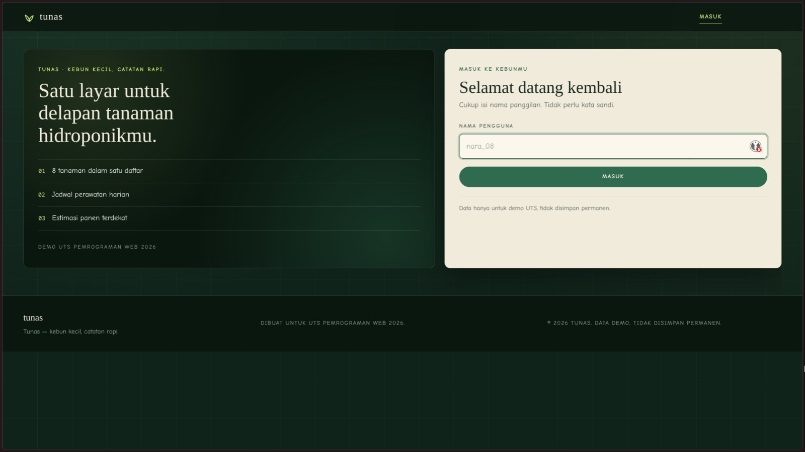
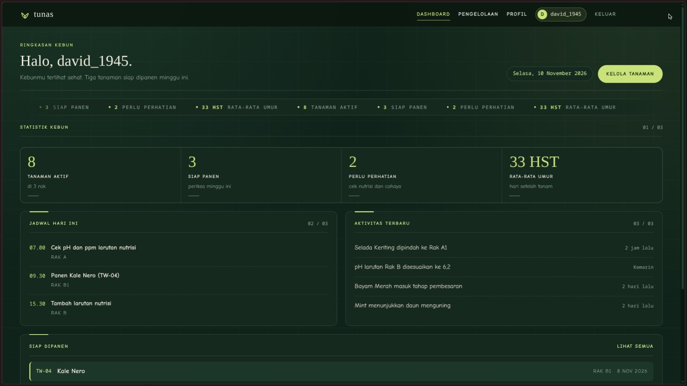
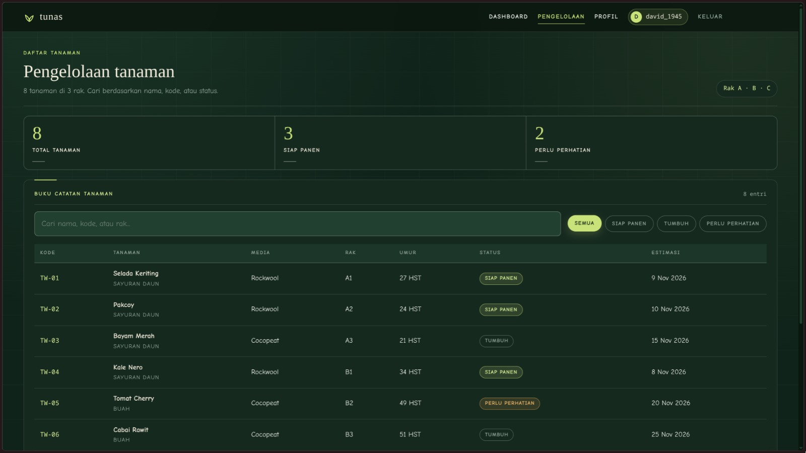
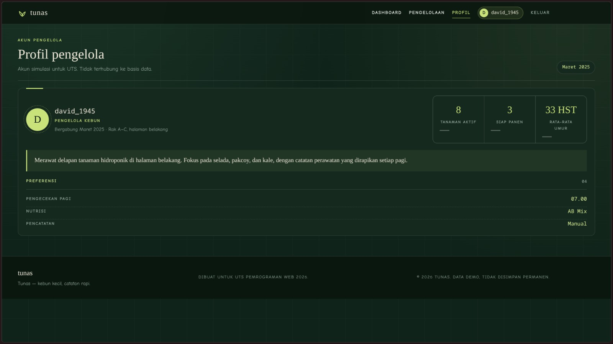

# Tunas

Tunas adalah aplikasi web sederhana untuk membantu memantau kebun hidroponik rumahan. Pengguna masuk dengan nama panggilan, lalu bisa melihat ringkasan kebun, jadwal perawatan hari ini, aktivitas terbaru, dan tanaman yang siap dipanen.

Selain dashboard, tersedia halaman pengelolaan untuk mencari dan memfilter delapan tanaman contoh berdasarkan statusnya, serta halaman profil yang menampilkan ringkasan kebun dan preferensi pengelola.

Aplikasi ini dibuat untuk UTS Pemrograman Web 2026 dengan Laravel 12 dan Blade. Tampilan menggunakan Tailwind CSS dan CSS sendiri, sedangkan pencarian, filter, serta animasi ditangani dengan JavaScript. Data tanaman masih statis dan tidak disimpan ke database.

## Tampilan

### Login

### Dashboard

### Pengelolaan tanaman

### Profil pengelola

## Identitas

David Dwi Wahyudi  
252410103005  
Kelas D
